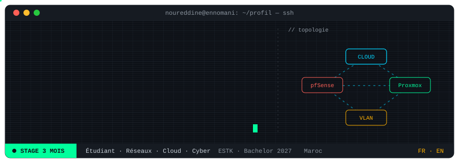

<p align="center">
  
</p>

<p align="center">
  <a href="#projets"></a>
  <a href="#outils"></a>
  <a href="#parcours"></a>
  <a href="#contact"></a>
  <a href="https://noureddineennomani96-dev.github.io"></a>
</p>

```bash
$ whoami
noureddine-ennomani

$ cat mission.txt
Étudiant en Réseaux, Cloud & Cybersécurité : je conçois, déploie et sécurise des infrastructures IT.
Des réseaux qui tiennent, des systèmes reproductibles, des accès contrôlés.

$ ./status --stage
[ OK ] Recherche un stage de 3 mois en réseaux, cloud et cybersécurité
       Étudiant Bachelor RCC · ESTK · diplôme prévu en 2027
```

<p align="center">
  
  
  
  
</p>

---

## projets

```bash
$ ls ~/projets
```

| Dépôt | Description |
|---|---|
| [`iaas-proxmox-tp-virtuels`](https://github.com/noureddineennomani96-dev/iaas-proxmox-tp-virtuels) | **PFE** · plateforme IaaS open source sur Proxmox VE pour des TP virtuels isolés et reproductibles |
| [`exam-management-system`](https://github.com/noureddineennomani96-dev/exam-management-system) | Système de gestion des examens (stage à la Direction Provinciale de l'Éducation Nationale) |
| [`Projet_VoIP`](https://github.com/noureddineennomani96-dev/Projet_VoIP) | Déploiement d'une téléphonie IP (Trixbox, Zoiper) |
| [`noureddineennomani96-dev.github.io`](https://noureddineennomani96-dev.github.io) | Portfolio : parcours, projets, compétences |
| [`TP1_POO`](https://github.com/noureddineennomani96-dev/TP1_POO) | Programmation orientée objet en Java |

**Architecture du PFE**

```text
 [ Enseignants / Étudiants ]      accès par rôles
              |
              v
 [ Scripts Bash + API ]           déploiement automatisé
              |
              v
 [ Proxmox VE ]                   KVM · LXC · templates · snapshots
              |
              v
 [ VM isolées ]                   CPU · RAM · stockage
```

**Labs (GNS3 / VM)**

```text
[+] Zero Trust Network ... OPNsense + Authelia
[+] Authentification ..... RADIUS · Active Directory · GPO
[+] Services réseau ...... DNS · DHCP · VLAN · OSPF
[+] Supervision .......... Nagios · Zabbix
[+] Web & conteneurs ..... Apache · Nginx · Docker
```

---

## outils

```bash
$ nmap --stack noureddine
```

**Langages**

<p>
  
  
  
  
  
  
  
</p>

**Infrastructure &amp; outils**

<p>
  
  
  
  
  
  
  
  
  
  
  
</p>

```text
RÉSEAUX .... TCP/IP · VLAN · STP · OSPF · BGP · VPN IPsec/SSL · SIP/RTP · RADIUS · LDAP
SÉCURITÉ ... pare-feux · DMZ · segmentation · hardening · PKI · MFA · Zero Trust · ISO 27001
CLOUD ...... Proxmox (KVM/LXC) · clustering · snapshots · VMware · OpenStack · Docker
SYSTÈMES ... Windows Server · Active Directory · GPO · Ubuntu · Debian · Kali
LANGAGES ... Python · Java · C · C++ · PHP · HTML · CSS
SCRIPTS .... Bash · PowerShell · API REST
```

---

## parcours

```text
2026 - 2027   Bachelor (DBT) Réseaux, Cloud & Cybersécurité ... ESTK, Université Cadi Ayyad
2024 - 2026   DUT Gestion des Réseaux et Sécurité ............. EST Ouarzazate
04-05 / 2026  Stage : système de gestion des examens .......... Direction Provinciale de l'Éducation Nationale
06-07 / 2025  Stage : solution VoIP ........................... Province d'Ouarzazate
2023          Baccalauréat Sciences Physiques et Chimiques
```

```bash
$ ls ~/certifications
```

<p>
  
  
  
</p>

<!--
Pour mettre les logos officiels à la place des badges :
1. Crée un dossier "certs" dans le dépôt et envoie-y tes images (anssi.png, cisco.png, fortinet.png)
2. Remplace les badges ci-dessus par :

<p align="center">
  
  
  
</p>
-->


---

## contact

```bash
$ ./contact.sh
```

- 🌐 Portfolio : [noureddineennomani96-dev.github.io](https://noureddineennomani96-dev.github.io)
- 📧 Email : noureddineennomani@gmail.com
- 💼 LinkedIn : [noureddine-ennomani](https://linkedin.com/in/noureddine-ennomani-45a077361)
- 🐙 GitHub : [@noureddineennomani96-dev](https://github.com/noureddineennomani96-dev)
